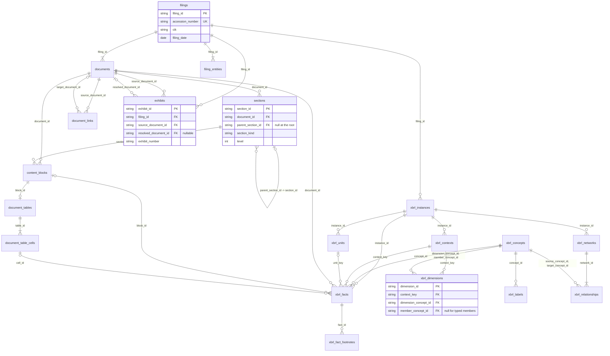

# SEC Silver data model (`sec_filings`)

This describes the Silver model **as the code writes it**: 19 Iceberg tables in namespace `sec_filings`, built from SEC Bronze by `scripts/sec_filings/build_silver.py`. The source of truth is the catalog and the code: schemas in `src/data_pipeline/contracts/sec_filings/`, table specs (identifier, schema, partition) in the `*_SPEC` constants of `src/data_pipeline/storage/sec_filings/`, stage order in `SILVER_STAGES` (`pipelines/sec_filings/silver_stages.py`), audited tables/keys/FKs in `quality/sec_filings/silver_model.py`, the audit in `quality/sec_filings/silver_audit.py`.

"Rows" are from `data/` (343 filings, 5 companies), measured 2026-10-07; each table has exactly one snapshot, except `sections`, `content_blocks`, `document_tables` and `document_table_cells` (2026-11-03: a second snapshot adds the EX-99 exhibits).

## 1. Tables

| Table | Grain (one row is…) | Primary key | Parent (FK) | Partition | Rows |
| --- | --- | --- | --- | --- | ---: |
| `filings` | one SEC submission (accession number) | `filing_id` | — | `year(filing_date)` | 343 |
| `documents` | one `<DOCUMENT>` block in `full-submission.txt` | `document_id` | `filings` | `year(filing_date)` | 12,809 |
| `filing_entities` | one entity-role block (`FILER:`…) in a filing's SEC header | `filing_entity_id` | `filings` | none | 343 |
| `sections` | one canonical section (root, PART, ITEM, SIGNATURES, EXHIBIT INDEX, TOC) of a narrative document (primary HTML, or an EX-99 HTML exhibit: root only) | `section_id` | `documents`, `sections` (parent) | `year(filing_date)` | 2,982 |
| `content_blocks` | one visible content block of a narrative document, in order | `block_id` | `documents`, `sections` | `year(filing_date)` | 97,432 |
| `document_tables` | one physical HTML table, matching exactly one `table` content block | `table_id` | `content_blocks` | `year(filing_date)` | 11,960 |
| `document_table_cells` | one visible cell of an HTML table | `cell_id` | `document_tables` | `year(filing_date)` | 1,152,209 |
| `document_links` | one `<a href>` in an HTML document | `link_id` | `documents` (source, target) | `year(filing_date)` | 365,221 |
| `exhibits` | one Exhibit Index entry declared in the primary document | `exhibit_id` | `filings`, `documents` (source, target) | `year(filing_date)` | 2,696 |
| `xbrl_instances` | one logical XBRL instance (Inline target or XML) of a filing | `instance_id` | `filings` | none | 343 |
| `xbrl_contexts` | one context of an instance | `context_key` | `xbrl_instances` | none | 30,319 |
| `xbrl_units` | one unit of an instance | `unit_key` | `xbrl_instances` | none | 699 |
| `xbrl_concepts` | one concept (expanded QName) across all DTSs; shared dictionary | `concept_id` | — | none | 140,764 |
| `xbrl_facts` | one reported fact occurrence | `fact_id` | `xbrl_instances`, `xbrl_concepts`, `xbrl_contexts`, `xbrl_units`, `documents`, `content_blocks`/`document_table_cells` | `bucket(32, instance_id)` | 133,384 |
| `xbrl_dimensions` | one dimension member declared in a context's segment/scenario | `dimension_id` | `xbrl_contexts`, `xbrl_concepts` | none | 43,405 |
| `xbrl_fact_footnotes` | one effective fact → footnote relationship | `footnote_relation_id` | `xbrl_facts` | none | 775 |
| `xbrl_labels` | one effective concept → label relationship; shared dictionary per DTS file | `label_id` | `xbrl_concepts` | none | 157,825 |
| `xbrl_networks` | one linkbase network (instance, linkbase type, role) | `network_id` | `xbrl_instances` | none | 14,918 |
| `xbrl_relationships` | one effective arc in a network | `relationship_id` | `xbrl_networks`, `xbrl_concepts` (source, target) | none | 338,171 |

Grain keys the audit checks for uniqueness besides the primary key: `filings.accession_number`; `(filing_id, document_ordinal)`; `(filing_id, entity_ordinal)`; `(document_id, section_ordinal)`; `(document_id, block_ordinal)`; `document_tables.block_id` and `(document_id, table_ordinal)`; `(table_id, cell_ordinal)`; `(source_document_id, link_ordinal)`; `(filing_id, exhibit_ordinal)`; `(instance_id, context_ref)`; `(instance_id, unit_ref)`; `(namespace_uri, local_name)`; `(instance_id, fact_order)`; `(context_key, dimension_ordinal)` and `(context_key, dimension_concept_id)`; `(fact_id, footnote_ordinal)`; `(instance_id, network_ordinal)` and `(instance_id, linkbase_type, role_uri)`; `(network_id, relationship_ordinal)`. Every child ID derives from its parent plus an ordinal (or hash); the row contract checks the derivation.

### Tables deliberately absent

- **`companies`.** Each of its attributes (`latest_company_name`, `sic_*`, `first/latest_seen_date`) is an aggregate over `filing_entities` that changes with every new filing, which does not fit append-only Silver; the only non-derivable attribute (`ticker_aliases`) comes from the iShares snapshot, not SEC. CIK is already the stable company identifier (10-digit string, checked in `filings.cik` and `filing_entities.cik`). It is a Gold dimension candidate.
- **`child_sections`, `section_children`, `section_hierarchy`.** The tree is `sections.parent_section_id → sections.section_id`.
- **`exhibits` is kept because its grain differs from `documents`.** An attached exhibit is a `documents` row with `role = 'exhibit'` (861); `exhibits` is an Exhibit Index line: 2,696 entries, of which 1,074 point to older filings (incorporated by reference) with no attachment. An entry points to its attachment through nullable `resolved_document_id`.

## 2. Relations and cardinality

Checked on real data: no orphans, every field copied from a parent matches it, every group is complete (section 6).

| Relation | Cardinality | Notes |
| --- | --- | --- |
| `filings` → `documents` | 1 — 1..N | 6–90 documents per filing |
| `filings` → `filing_entities` | 1 — 1..N | `data/`: exactly 1 entity (`filer`) per filing; multi-registrant 8-Ks have more |
| `documents` → `sections` / `content_blocks` | 1 — 0..N | only narrative documents (primary HTML, EX-99 HTML exhibits) have narrative; each parsed document has exactly 1 root; an exhibit has only its root; an exhibit without visible text has no rows |
| `sections.parent_section_id` → `sections` | 0..1 — 0..N | root has null parent; PART → ITEM; parent is in the same document, level = parent level + 1 (no cycles); parent range contains child range |
| `sections` → `content_blocks` | 1 — 0..N | each block belongs to the deepest section containing it |
| `content_blocks` → `document_tables` | 1 — 0..1 | only `table` blocks, each with exactly 1 table |
| `document_tables` → `document_table_cells` | 1 — 1..N | no self-reference for nested tables (a nested table is its own block) |
| `documents` → `document_links` (source) | 1 — 0..N | |
| `documents` → `document_links` (target, nullable `target_document_id`) | 0..1 — 0..N | resolved only within the same filing; fragments/email/external are not forced to resolve; no `target_exhibit_id` |
| `filings` → `exhibits` | 1 — 0..N | 278/343 filings have an Exhibit Index |
| `documents` → `exhibits` (`source_document_id`) | 1 — 0..N | always the filing's primary document |
| `documents` → `exhibits` (`resolved_document_id`, nullable) | 0..1 — 0..N | same filing; 985 entries resolved |
| `filings` → `xbrl_instances` | 1 — 0..N | `data/`: exactly 1 per filing |
| `xbrl_instances` → `xbrl_contexts` / `xbrl_units` / `xbrl_facts` / `xbrl_networks` | 1 — 0..N | match `context_count`, `unit_count`, `fact_count`, `instance_network_count` |
| `xbrl_concepts` / `xbrl_contexts` → `xbrl_facts` | 1 — 0..N | a fact's context and unit belong to its own instance |
| `xbrl_units` → `xbrl_facts` (nullable `unit_key`) | 0..1 — 0..N | non-numeric facts have no unit |
| `content_blocks` / `document_table_cells` → `xbrl_facts` | 0..1 — 0..N | see section 4 |
| `xbrl_contexts` → `xbrl_dimensions` | 1 — 0..N | exactly the members `segment_xml`/`scenario_xml` declare |
| `xbrl_facts` → `xbrl_fact_footnotes` | 1 — 0..N | |
| `xbrl_concepts` → `xbrl_labels` | 1 — 0..N | 14 roles, 1 language (`en-us`) in `data/` |
| `xbrl_networks` → `xbrl_relationships` | 1 — 1..N | no empty networks; networks link to the instance directly, not through facts |
| `xbrl_concepts` → `xbrl_relationships` (source, target) | 1 — 0..N | every endpoint exists in `xbrl_concepts` |

## 3. ERD



## 4. Lineage to Bronze

| Table | Traces back to |
| --- | --- |
| `filings` | `full_submission_path` + `full_submission_sha256`, `primary_document_path` + `primary_document_sha256` (POSIX paths relative to the data dir) |
| `documents` | `source_path`, `source_submission_sha256`, byte spans `document_start_byte..document_end_byte`, `content_start_byte..content_end_byte`, `content_sha256` |
| `filing_entities` | `source_path`, `entity_start_byte..entity_end_byte`, `entity_block_sha256` |
| `sections`, `content_blocks`, `document_tables`, `document_table_cells`, `document_links` | `document_id` + `source_xpath` (lxml `getpath()` of the parsed DOM) + `source_document_sha256` (= `documents.content_sha256` of the parsed version) |
| `exhibits` | `source_document_id` + `source_xpath` of the `tr` |
| `xbrl_instances` | `source_document_ids` + `source_set_sha256` |
| `xbrl_facts` | `document_id` (the fact's Inline or XML source) + `source_xpath`; `block_id`/`cell_id` when located with certainty |
| `xbrl_labels`, `xbrl_relationships` | `source_document_id`: a `document_id` when the DTS file belongs to the filing, a URL for published taxonomies; plus `source_xpath`/`arc_xpath` |
| `xbrl_concepts` | `source_schema_uri` (where first read) |

`xbrl_facts.cell_id`/`block_id` are **not heuristic**: the fact's `ix:*` element lies inside that `td`/block in the same DOM parse (exact XPath match). Hidden facts, facts spanning several blocks, and XPaths matching several blocks stay null rather than guessed. No cell ↔ fact matching by value or text. In `data/`: 108,020 facts linked to a cell, 16,930 to a block, none to both.

## 5. Derivable fields kept on purpose

| Field | Tables | Kind | Reason |
| --- | --- | --- | --- |
| `filing_id` | sections, content_blocks, document_tables, document_table_cells, document_links, exhibits | query + integrity | filter by filing without 2–4 joins (cell → table → block → document → filing); the audit checks each value against the parent. XBRL child tables do not copy filing columns |
| `filing_date` | 9 filing/document/HTML/exhibit tables | partition | source of `year(filing_date)`; audit checks it matches the parent |
| `document_id` | content_blocks, document_tables, document_table_cells | query + integrity | stage and audit groups are per document; parent match is checked |
| `xbrl_facts.document_id` | xbrl_facts | source | an instance can have 2 sources (Inline + XML); not derivable from the instance |
| `source_document_sha256` | sections, content_blocks, document_tables, document_table_cells, document_links | integrity | which document version a group was built from; stages use it to skip or conflict, the audit checks it against `documents.content_sha256`. Dictionary-encoded in Parquet, so nearly free |
| `document_*_count`, `table_cell_count`, `filing_exhibit_count`, `context_dimension_count`, `fact_footnote_count`, `instance_network_count`, `network_relationship_count` | child tables | integrity | detects truncated groups (declared count vs ordinals 1..N) |
| `fact_count`, `context_count`, `unit_count`, `relationship_count` | instances, networks | integrity | child count matches the parent total |
| `row_count`, `column_count`, `cell_count`, `header_cell_count` | document_tables | integrity + query | `cell_count` checks the cells; table shape without reading cells. `header_cell_count` is always 0 in `data/` (SEC does not use `<th>`) but is generic HTML semantics |
| `text_length` | content_blocks, document_table_cells | query | derivable from `text` (contract checks equality); filter by length without reading text |
| `section_text_sha256`, `table_content_sha256`, `network_hash`, `fact_sha256`, `context_hash`, `dimension_hash`, `label_text_sha256`, `relationship_hash`, `footnote_content_sha256`, `source_text_sha256` | | integrity | proves deterministic extraction; stages compare stored groups with rebuilt ones |
| `source_xpath`, `arc_xpath` | | lineage | position in the source file |
| `processed_at` | all | lineage | batch time; excluded from every comparison and hash |
| `inside_table` | content_blocks | redundant, kept | equals `source_table_xpath is not null` (contract checks); only matters for nested tables, none in `data/`. Removing it needs a controlled rebuild of `sections` + `content_blocks` with no measurable gain; deferred to the next narrative rebuild |

`xbrl_dimensions` has **context-level** grain: key `context_key`, no `fact_id`. The stage reads members from the context's segment/scenario, and the expected row count derives from the stored `segment_xml`/`scenario_xml`. 61,776 facts use 28,832 dimensional contexts (4.4 facts per context), so per-fact rows would multiply volume with no new meaning; join with `xbrl_facts.context_key = xbrl_dimensions.context_key`.

## 6. Integrity audit

One audit implementation (`quality/sec_filings/silver_audit*.py`; tables, keys and FKs declared in `silver_model.py`), run by the final `integrity` stage, `build_silver.py --check-only` and `scripts/sec_filings/audit_silver.py` (adds `--sample-per-form`, `--batch-size`, `--verify-source-hashes`). Read-only: the catalog is opened read-only, no tables are created, and table metadata plus catalog/warehouse file stats must be equal before and after. Memory does not grow with row count: Parquet files are read in batches, key/lineage/group columns go to a scratch DuckDB database on disk and are checked with SQL. Checks:

- the catalog has all 19 tables the code defines (unknown tables warn);
- pydantic contract ↔ Arrow schema ↔ Iceberg schema (field IDs, types, nullability) ↔ each Parquet file's schema and field IDs; partition spec and rules version (the `lexifin.rules-version` table property, AGENTS.md) equal the code's; location, file/record counts match the snapshot summary;
- every row's contract (allowed values, timezone-aware timestamps, hash formats, finite decimals, derived IDs and hashes);
- primary keys and the grain keys of section 1;
- 32 foreign keys plus fields copied from the parent (`filing_id`, `document_id`, `filing_date`, `source_document_sha256`, `source_path`…); nullable FKs checked only when non-null;
- groups: ordinals 1..N and declared counts of every group; parent-declared counts (`fact_count`, `context_count`, `unit_count`, `cell_count`, `relationship_count`, members per context);
- cardinality and semantics: each filing has documents, entities and exactly one primary document of the same form; narrative only on narrative documents (primary HTML, EX-99 HTML), every primary HTML has sections; section tree (one root, no self-parent, parent level lower, nested ranges, increasing starts, root covers every block, block in its deepest section); `table` blocks point to a `<table>` and have exactly one `document_tables` row, no `table_cell` blocks remain; cell header counts and grid; links only from HTML; exhibits read from the primary document; instance sources belong to the filing, are ordered, and `source_set_sha256` is recomputed; facts come from the instance's source documents; consistent footnote resources; relationship attributes per linkbase type; label/relationship `source_document_id` is a stored document of the same filing or a URL;
- Bronze: every filing's files are inside the Bronze dir and exist; `--verify-source-hashes` rehashes every submission, primary document, and document/entity span;
- sampled lineage: the latest filing of each form (10-K, 10-Q, 8-K) is rebuilt from Bronze with the stage code (documents, entities, and sections, blocks, tables, cells of every narrative document) and compared with Silver; `section_text_sha256`, `table_content_sha256`, block text vs joined cells, and `network_hash` are recomputed only on samples, since they need a whole group's text.

Result on `data/` (2026-10-07, SQLite scratch before the DuckDB switch): 263 PASS, 2 WARN (149 `public_document_count`, 1,154 unresolved links), 0 FAIL, 1 SKIP (`source_hashes` without `--verify-source-hashes`); ~80 s, peak RSS ~0.7 GB, ~1.1 GB scratch on disk.

## 7. Typical joins

These queries run in `tests/integration/sec_filings/test_full_silver_pipeline.py` (DuckDB on Arrow read through PyIceberg). None splits composite IDs to join or depends on row order.

```sql
-- 1. A company's filings over time
select f.form, f.filing_date from filing_entities e
join filings f on f.filing_id = e.filing_id
where e.cik = '0000320193' order by f.filing_date;

-- 2. Ordered content of Item 1A (section range [start, end))
select b.text from filings f
join documents d on d.filing_id = f.filing_id and d.role = 'primary_document'
join sections s on s.document_id = d.document_id
join content_blocks b on b.document_id = s.document_id
 and b.block_ordinal >= s.start_block_ordinal and b.block_ordinal < s.end_block_ordinal
where f.filing_id = ? and s.section_code = 'ITEM 1A' order by b.block_ordinal;

-- 3. Root → PART → ITEM by self-join
select p.section_code, c.section_code from sections c
join sections p on p.section_id = c.parent_section_id
join sections r on r.section_id = p.parent_section_id
where c.document_id = ? and r.parent_section_id is null order by c.section_ordinal;

-- 4. Rebuild an HTML table's grid
select c.row_ordinal, c.column_ordinal, c.rowspan, c.colspan, c.text
from content_blocks b join document_tables t on t.block_id = b.block_id
join document_table_cells c on c.table_id = t.table_id
where b.block_id = ? order by c.cell_ordinal;

-- 5. A filing's Exhibit Index and attachments (if any)
select x.exhibit_number, x.description, x.href, d.filename from exhibits x
left join documents d on d.document_id = x.resolved_document_id
where x.filing_id = ? order by x.exhibit_ordinal;
-- attachments: select * from documents where filing_id = ? and role = 'exhibit'

-- 6. Facts with concept, context, unit and dimensions (one row per dimension)
select c.local_name, f.numeric_value, x.period_type, x.end_date, u.normalized_expression,
       dc.local_name, coalesce(m.local_name, d.typed_member_value)
from xbrl_facts f
join xbrl_concepts c on c.concept_id = f.concept_id
join xbrl_contexts x on x.context_key = f.context_key
left join xbrl_units u on u.unit_key = f.unit_key
left join xbrl_dimensions d on d.context_key = f.context_key
left join xbrl_concepts dc on dc.concept_id = d.dimension_concept_id
left join xbrl_concepts m on m.concept_id = d.member_concept_id
where f.instance_id = ?;

-- 7. Network → relationship → concept → label within the instance's DTS
--    (one label per relationship: the filing's own label first, then the published taxonomy)
with dts_labels as (
  select l.concept_id, l.label_text, d.filing_id from xbrl_labels l
  left join documents d on d.document_id = l.source_document_id
  where l.role_uri = 'http://www.xbrl.org/2003/role/label' and l.language = 'en-us')
select n.linkbase_type, n.role_uri, s.local_name, t.local_name, l.label_text
from xbrl_networks n
join xbrl_instances i on i.instance_id = n.instance_id
join xbrl_relationships r on r.network_id = n.network_id
join xbrl_concepts s on s.concept_id = r.source_concept_id
join xbrl_concepts t on t.concept_id = r.target_concept_id
left join dts_labels l on l.concept_id = t.concept_id
 and (l.filing_id = i.filing_id or l.filing_id is null)
where n.instance_id = ?
qualify row_number() over (partition by r.relationship_id order by l.filing_id is null) = 1;

-- 8. Provenance: block/cell → document → filing; fact → document (+ cell);
--    relationship → DTS file
select f.full_submission_path, d.document_start_byte, d.content_sha256, b.source_xpath
from content_blocks b join documents d on d.document_id = b.document_id
join filings f on f.filing_id = d.filing_id where b.block_id = ?;
```

`xbrl_labels` is a dictionary over all DTS files: one concept has labels from many filings (each filing's extension) and from published taxonomies. To get an instance's labels, filter as in query 7 (file of the instance's filing, or a URL), or rows multiply. Even within one DTS a concept can have two effective labels with the same role and language when the filer redefines a standard concept's label: 109 concepts in Apple's FY2025 10-K DTS (e.g. `ecd`) have labels in both `aapl-20250927_lab.xml` and `ecd-sub-2025.xsd`. Query 7 picks the filer's label and returns exactly 767 rows for the 767 presentation relationships of that DTS.

## 8. Known limits

- `xbrl_labels.source_document_id` and `xbrl_relationships.source_document_id` hold two kinds of value (`document_id` or taxonomy URL) under one column name. Contract and audit tell them apart, but the FK only applies to non-URLs. Splitting into `source_document_id` (nullable FK) + `source_uri` is breaking: it changes `label_id` and needs a controlled rebuild of `xbrl_labels` + `xbrl_networks` + `xbrl_relationships` (~16 min offline). Not done.
- `filings.accepted_at` is naive time as EDGAR writes it (US Eastern, no offset); not converted to UTC.
- `filings.public_document_count` is unreliable (149/343 filings exceed the real `<DOCUMENT>` count): warning only.
- `inside_table` duplicates `source_table_xpath` (section 5).
- The integrity gate rehashes Bronze only for sampled filings; use `scripts/sec_filings/audit_silver.py --verify-source-hashes` to rehash all.
- No lock: do not run two builds on one `--data-dir`. No global rollback: a conflict found while classifying rejects the stage before its first write; a failed batch blocks only itself, earlier batches stay committed and are skipped next run.
- Stages skip stored groups by source hash, so a rule change is caught only by the rules version (AGENTS.md): a table's `rules_version` must be bumped with the change, which the fixture rows digest test enforces only as far as the fixtures reach. `exhibits` is also rebuilt and compared on every run.

## 9. Performance (`data/`, 2026-10-07)

- Full build (offline, warm taxonomy cache): ~41 min, peak RSS ~2.6 GB; the three XBRL stages take ~36 min (Arelle loads each instance's DTS). Rerun with no new Bronze: ~1.5 min, peak RSS ~0.75 GB; each table stage 2–5 s and ≤ 0.4 GB, integrity ~75 s. Stages read group summaries instead of rows and commit in batches, so memory follows batch size and group count, not row count (AGENTS.md).
- Audit (`--check-only`, `integrity` stage, `audit_silver.py`): ~80 s, peak RSS ~0.7 GB (batch reads ~60 s, mostly per-row contract validation; SQL ~15 s; lineage of 3 sampled filings ~4 s), ~1.1 GB scratch on disk (SQLite scratch before the DuckDB switch).
- Size: ~98 MB of Parquet. Largest: `xbrl_relationships` (26 MB, 1 file), `xbrl_facts` (23 MB, 32 files from `bucket(32, instance_id)`), `xbrl_labels` (13 MB), `xbrl_concepts` (10 MB), `document_table_cells` (9 MB, 6 files by year). One snapshot per table.
- Typical queries (DuckDB on Arrow, after loading the needed columns in ~0.4 s): 3–90 ms for queries 1–6 and 8, ~0.4–0.7 s for query 7 (DTS label filter).
- Partitioning unchanged: data is small, year-partitioned tables have 6 files each; `xbrl_facts` has 32 small files (~0.7 MB) but no measured query pattern is slowed by it. Change partitioning only with a concrete query and measurements.
