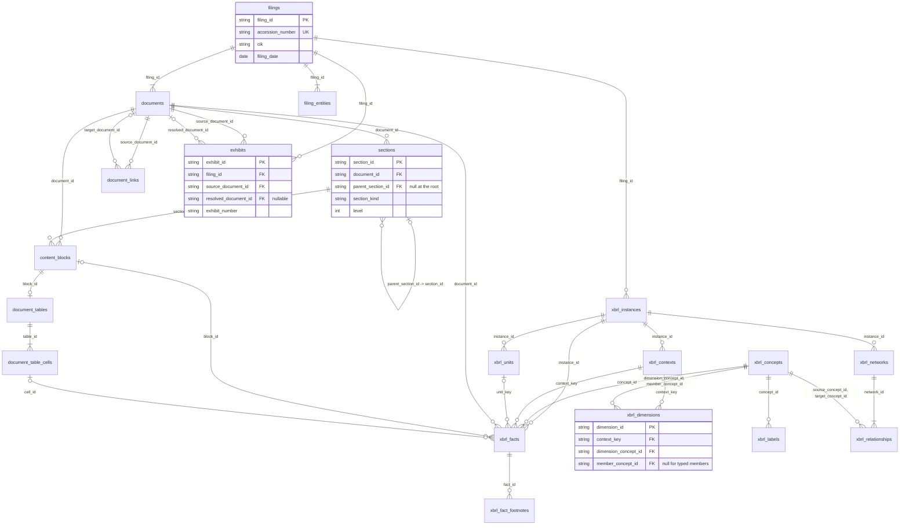

# SEC Silver data model (`sec_filings`)

Tài liệu này mô tả model Silver **đúng như code đang ghi**: 19 bảng Iceberg trong namespace `sec_filings`, dựng từ SEC Bronze bằng `scripts/sec_filings/build_silver.py`. Nguồn sự thật là catalog và code: schema ở `src/data_pipeline/contracts/sec_filings/`, định nghĩa bảng (identifier + schema + partition) ở các `*_SPEC` của `src/data_pipeline/storage/sec_filings/`, thứ tự stage ở `SILVER_STAGES` (`pipelines/sec_filings/silver_stages.py`), bảng/khoá/FK mà audit kiểm ở `quality/sec_filings/silver_model.py`, audit ở `quality/sec_filings/silver_audit.py`. `src/data_pipeline/bronze-silver.md` là ghi chú thiết kế ban đầu, không phải mô tả hiện trạng.

Số liệu "Rows" là của `data/` (343 filing của 5 công ty), đo ngày 2026-10-07; mỗi bảng có đúng 1 snapshot.

## 1. Bảng trong model

| Bảng | Grain (một row là…) | Primary key | Cha (FK) | Partition | Rows | Quyết định |
| --- | --- | --- | --- | --- | ---: | --- |
| `filings` | một SEC submission (accession number) | `filing_id` | — | `year(filing_date)` | 343 | giữ |
| `documents` | một block `<DOCUMENT>` trong `full-submission.txt` | `document_id` | `filings` | `year(filing_date)` | 12.809 | giữ |
| `filing_entities` | một block entity-role (`FILER:`…) trong SEC header của một filing | `filing_entity_id` | `filings` | không | 343 | giữ |
| `sections` | một section quy chuẩn (root, PART, ITEM, SIGNATURES, EXHIBIT INDEX, TOC) phát hiện trong primary HTML | `section_id` | `documents`, `sections` (cha) | `year(filing_date)` | 2.803 | giữ |
| `content_blocks` | một block nội dung nhìn thấy được, theo thứ tự, của primary HTML | `block_id` | `documents`, `sections` | `year(filing_date)` | 83.301 | giữ |
| `document_tables` | một bảng HTML vật lý, ứng với đúng một content block `table` | `table_id` | `content_blocks` | `year(filing_date)` | 10.184 | giữ |
| `document_table_cells` | một cell nhìn thấy được của một bảng HTML | `cell_id` | `document_tables` | `year(filing_date)` | 878.380 | giữ |
| `document_links` | một `<a href>` trong một document HTML | `link_id` | `documents` (nguồn, đích) | `year(filing_date)` | 365.221 | giữ |
| `exhibits` | một dòng Exhibit Index mà filing khai báo trong primary document | `exhibit_id` | `filings`, `documents` (nguồn, đích) | `year(filing_date)` | 2.696 | giữ |
| `xbrl_instances` | một XBRL instance logic (Inline target hoặc XML) của một filing | `instance_id` | `filings` | không | 343 | giữ |
| `xbrl_contexts` | một context của một instance | `context_key` | `xbrl_instances` | không | 30.319 | giữ |
| `xbrl_units` | một unit của một instance | `unit_key` | `xbrl_instances` | không | 699 | giữ |
| `xbrl_concepts` | một concept (expanded QName) của mọi DTS, từ điển dùng chung | `concept_id` | — | không | 140.764 | giữ |
| `xbrl_facts` | một fact occurrence được báo cáo | `fact_id` | `xbrl_instances`, `xbrl_concepts`, `xbrl_contexts`, `xbrl_units`, `documents`, `content_blocks`/`document_table_cells` | `bucket(32, instance_id)` | 133.384 | giữ |
| `xbrl_dimensions` | một dimension member khai báo trong segment/scenario của một context | `dimension_id` | `xbrl_contexts`, `xbrl_concepts` | không | 43.405 | giữ |
| `xbrl_fact_footnotes` | một quan hệ fact → footnote hiệu lực | `footnote_relation_id` | `xbrl_facts` | không | 775 | giữ |
| `xbrl_labels` | một quan hệ concept → label resource hiệu lực, từ điển dùng chung theo file DTS | `label_id` | `xbrl_concepts` | không | 157.825 | giữ |
| `xbrl_networks` | một network linkbase (instance, loại linkbase, role) | `network_id` | `xbrl_instances` | không | 14.918 | giữ |
| `xbrl_relationships` | một arc hiệu lực trong một network | `relationship_id` | `xbrl_networks`, `xbrl_concepts` (nguồn, đích) | không | 338.171 | giữ |

Khoá grain (composite) audit kiểm tra là duy nhất, ngoài primary key: `filings.accession_number`; `(filing_id, document_ordinal)`; `(filing_id, entity_ordinal)`; `(document_id, section_ordinal)`; `(document_id, block_ordinal)`; `document_tables.block_id` và `(document_id, table_ordinal)`; `(table_id, cell_ordinal)`; `(source_document_id, link_ordinal)`; `(filing_id, exhibit_ordinal)`; `(instance_id, context_ref)`; `(instance_id, unit_ref)`; `(namespace_uri, local_name)`; `(instance_id, fact_order)`; `(context_key, dimension_ordinal)` và `(context_key, dimension_concept_id)`; `(fact_id, footnote_ordinal)`; `(instance_id, network_ordinal)` và `(instance_id, linkbase_type, role_uri)`; `(network_id, relationship_ordinal)`. ID của mọi bảng con được dẫn xuất từ cha + ordinal (hoặc hash), và contract từng row kiểm tra việc dẫn xuất đó.

### Bảng không có, hoặc cố ý không tạo

- **`companies`: không tạo.** Mỗi thuộc tính của nó (`latest_company_name`, `sic_*`, `first/latest_seen_date`) là tổng hợp trên `filing_entities`, và thay đổi mỗi khi có filing mới, nên không hợp với Silver chỉ-append; thuộc tính duy nhất không suy ra được (`ticker_aliases`) đến từ snapshot iShares, không phải SEC. CIK đã là định danh công ty ổn định (chuỗi 10 chữ số, kiểm tra cả ở `filings.cik` lẫn `filing_entities.cik`). Đây là ứng viên dimension ở Gold.
- **`child_sections`, `section_children`, `section_hierarchy`: không có.** Cây section nằm trong `sections.parent_section_id → sections.section_id`.
- **`exhibits`: giữ, vì grain khác `documents`.** Exhibit đính kèm là row `documents` với `role = 'exhibit'` (861); `exhibits` là dòng Exhibit Index: 2.696 entry, trong đó 1.074 trỏ tới hồ sơ cũ (incorporated by reference) và không có file đính kèm nào tương ứng. Hai khái niệm không được trộn: một entry trỏ tới attachment qua `resolved_document_id` (nullable).

Không có bảng nào bị xoá hay đổi tên trong lần audit này, và không field nào bị xoá hay đổi tên.

## 2. Quan hệ và cardinality

Kiểm trên dữ liệu thật: không có orphan, mọi field copy từ cha đều khớp cha, mọi group đầy đủ (xem mục 6).

| Quan hệ | Cardinality | Ghi chú |
| --- | --- | --- |
| `filings` → `documents` | 1 — 1..N | 6–90 document mỗi filing |
| `filings` → `filing_entities` | 1 — 1..N | trong `data/` mỗi filing có đúng 1 entity (`filer`); 8-K nhiều registrant sẽ có nhiều |
| `documents` → `sections` / `content_blocks` | 1 — 0..N | chỉ primary document HTML có narrative; mỗi document được parse có đúng 1 root |
| `sections.parent_section_id` → `sections` | 0..1 — 0..N | root có parent null; PART → ITEM; cha luôn cùng document, level đúng bằng level cha + 1 nên không có cycle; range của cha chứa range của con |
| `sections` → `content_blocks` | 1 — 0..N | mỗi block thuộc đúng 1 section sâu nhất chứa nó |
| `content_blocks` → `document_tables` | 1 — 0..1 | chỉ block `table`, và mỗi block `table` có đúng 1 bảng |
| `document_tables` → `document_table_cells` | 1 — 1..N | không có self-reference cho bảng lồng (bảng lồng là block riêng) |
| `documents` → `document_links` (nguồn) | 1 — 0..N | |
| `documents` → `document_links` (đích, `target_document_id` nullable) | 0..1 — 0..N | chỉ resolve trong cùng filing; fragment/email/external không bị ép resolve; không có `target_exhibit_id` |
| `filings` → `exhibits` | 1 — 0..N | 278/343 filing có Exhibit Index |
| `documents` → `exhibits` (`source_document_id`) | 1 — 0..N | luôn là primary document của filing |
| `documents` → `exhibits` (`resolved_document_id`, nullable) | 0..1 — 0..N | cùng filing; 985 entry resolve |
| `filings` → `xbrl_instances` | 1 — 0..N | `data/`: đúng 1 mỗi filing |
| `xbrl_instances` → `xbrl_contexts` / `xbrl_units` / `xbrl_facts` / `xbrl_networks` | 1 — 0..N | khớp `context_count`, `unit_count`, `fact_count`, `instance_network_count` |
| `xbrl_concepts` / `xbrl_contexts` → `xbrl_facts` | 1 — 0..N | context và unit của fact thuộc chính instance của nó |
| `xbrl_units` → `xbrl_facts` (`unit_key` nullable) | 0..1 — 0..N | fact non-numeric không có unit |
| `content_blocks` / `document_table_cells` → `xbrl_facts` | 0..1 — 0..N | xem mục 4 |
| `xbrl_contexts` → `xbrl_dimensions` | 1 — 0..N | đúng số member mà `segment_xml`/`scenario_xml` khai báo |
| `xbrl_facts` → `xbrl_fact_footnotes` | 1 — 0..N | |
| `xbrl_concepts` → `xbrl_labels` | 1 — 0..N | 14 role, 1 ngôn ngữ (`en-us`) trong `data/` |
| `xbrl_networks` → `xbrl_relationships` | 1 — 1..N | không có network rỗng; network nối thẳng với instance, không suy qua fact |
| `xbrl_concepts` → `xbrl_relationships` (nguồn, đích) | 1 — 0..N | mọi endpoint có trong `xbrl_concepts` |

## 3. ERD



## 4. Lineage về Bronze

| Bảng | Truy ngược về |
| --- | --- |
| `filings` | `full_submission_path` + `full_submission_sha256`, `primary_document_path` + `primary_document_sha256` (đường dẫn POSIX tương đối với data dir) |
| `documents` | `source_path`, `source_submission_sha256`, byte span `document_start_byte..document_end_byte`, `content_start_byte..content_end_byte`, `content_sha256` |
| `filing_entities` | `source_path`, `entity_start_byte..entity_end_byte`, `entity_block_sha256` |
| `sections`, `content_blocks`, `document_tables`, `document_table_cells`, `document_links` | `document_id` + `source_xpath` (lxml `getpath()` trong DOM đã parse) + `source_document_sha256` (= `documents.content_sha256` của phiên bản đã parse) |
| `exhibits` | `source_document_id` + `source_xpath` của dòng `tr` |
| `xbrl_instances` | `source_document_ids` + `source_set_sha256` |
| `xbrl_facts` | `document_id` (Inline hoặc XML nguồn của fact) + `source_xpath`; `block_id`/`cell_id` khi định vị chắc chắn |
| `xbrl_labels`, `xbrl_relationships` | `source_document_id`: `document_id` khi file DTS thuộc filing, URL khi là taxonomy công bố; + `source_xpath`/`arc_xpath` |
| `xbrl_concepts` | `source_schema_uri` (nơi đọc thấy lần đầu) |

`xbrl_facts.cell_id`/`block_id` **không phải heuristic**: phần tử `ix:*` của fact nằm trong chính phần tử `td`/block đó trong cùng một lần parse DOM (so XPath chính xác); fact ẩn, fact trải nhiều block, hay XPath trùng nhiều block đều để null thay vì đoán. Không có ghép cell ↔ fact theo giá trị hay text. Trong `data/`: 108.020 fact gắn cell, 16.930 gắn block, không fact nào gắn cả hai.

## 5. Field được giữ dù có thể suy ra (denormalization có chủ đích)

| Field | Bảng | Phân loại | Lý do |
| --- | --- | --- | --- |
| `filing_id` | sections, content_blocks, document_tables, document_table_cells, document_links, exhibits | KEEP_QUERY_DENORMALIZATION + KEEP_INTEGRITY | lọc theo filing không cần 2–4 join (cell → table → block → document → filing); audit kiểm từng giá trị khớp cha. Bảng XBRL con không copy filing columns |
| `filing_date` | 9 bảng filing/document/HTML/exhibits | KEEP_PARTITION | nguồn của partition `year(filing_date)`; audit kiểm khớp cha |
| `document_id` | content_blocks, document_tables, document_table_cells | KEEP_QUERY_DENORMALIZATION + KEEP_INTEGRITY | group của stage và của audit là theo document; khớp cha được kiểm |
| `xbrl_facts.document_id` | xbrl_facts | KEEP_SOURCE | instance có thể có 2 nguồn (Inline + XML); không suy ra được từ instance |
| `source_document_sha256` | sections, content_blocks, document_tables, document_table_cells, document_links | KEEP_INTEGRITY | group được dựng từ phiên bản document nào; stage dùng để skip/conflict, audit kiểm bằng `documents.content_sha256`. Lặp trên nhiều row nhưng Parquet dictionary-encode nên gần như không tốn chỗ |
| `document_*_count`, `table_cell_count`, `filing_exhibit_count`, `context_dimension_count`, `fact_footnote_count`, `instance_network_count`, `network_relationship_count` | các bảng con | KEEP_INTEGRITY | phát hiện group bị cắt đuôi (count khai báo so với ordinal 1..N) |
| `fact_count`, `context_count`, `unit_count`, `relationship_count` | instances, networks | KEEP_INTEGRITY | số con khớp tổng ở cha |
| `row_count`, `column_count`, `cell_count`, `header_cell_count` | document_tables | KEEP_INTEGRITY + KEEP_QUERY_DENORMALIZATION | `cell_count` kiểm số cell; shape bảng không cần đọc cell. `header_cell_count` luôn 0 trong `data/` (SEC không dùng `<th>`) nhưng là ngữ nghĩa HTML chung |
| `text_length` | content_blocks, document_table_cells | KEEP_QUERY_DENORMALIZATION | suy ra được từ `text` (contract kiểm bằng nhau); lọc theo độ dài mà không đọc text |
| `section_text_sha256`, `table_content_sha256`, `network_hash`, `fact_sha256`, `context_hash`, `dimension_hash`, `label_text_sha256`, `relationship_hash`, `footnote_content_sha256`, `source_text_sha256` | | KEEP_INTEGRITY | xác minh extraction tất định; stage so group đã lưu với group dựng lại |
| `source_xpath`, `arc_xpath` | | KEEP_LINEAGE | vị trí trong file nguồn |
| `processed_at` | mọi bảng | KEEP_LINEAGE | thời điểm batch; bị loại khỏi mọi phép so sánh và hash |
| `inside_table` | content_blocks | dư thừa nhưng giữ | bằng `source_table_xpath is not null` (contract kiểm); chỉ có ý nghĩa cho bảng lồng, `data/` không có bảng lồng nào. Xoá cần rebuild có kiểm soát `sections` + `content_blocks`, không có lợi đo được → để lần rebuild narrative sau |

`xbrl_dimensions` có grain **mức context** (khả năng A): khoá `context_key`, không có `fact_id`; stage đọc member từ segment/scenario của context, và số row mong đợi suy từ `segment_xml`/`scenario_xml` đã lưu. 61.776 fact dùng 28.832 context có dimension (trung bình 4,4 fact/context), nên flatten theo fact sẽ nhân số row mà không thêm ngữ nghĩa; fact lấy dimension bằng `xbrl_facts.context_key = xbrl_dimensions.context_key`.

## 6. Integrity audit

Một cài đặt audit duy nhất (`quality/sec_filings/silver_audit*.py`; bảng, khoá và FK khai báo ở `silver_model.py`), chạy bởi stage cuối `integrity` của pipeline, `build_silver.py --check-only` và `scripts/sec_filings/audit_silver.py` (thêm `--sample-per-form`, `--batch-size`, `--verify-source-hashes`). Chỉ đọc: catalog mở read-only, không tạo bảng, metadata bảng và stat file catalog/warehouse trước/sau phải bằng nhau. Bộ nhớ không tăng theo số row: đọc từng file Parquet theo batch, cột khoá/lineage/group được chép vào một SQLite tạm trên đĩa và kiểm bằng SQL. Kiểm:

- catalog đủ 19 bảng code định nghĩa (bảng lạ là warning), tên `sec_filings.documents`;
- contract Pydantic ↔ schema Arrow ↔ schema Iceberg (field ID, kiểu, nullability) ↔ schema và field ID của từng file Parquet; partition spec, location, số file/record khớp snapshot summary;
- contract từng row (giá trị cho phép, timestamp có timezone, định dạng hash, decimal hữu hạn, ID và hash dẫn xuất của row);
- primary key và các khoá grain ở mục 1;
- 32 foreign key kèm field copy từ cha (`filing_id`, `document_id`, `filing_date`, `source_document_sha256`, `source_path`…); FK nullable chỉ kiểm khi khác null;
- group: ordinal 1..N và count khai báo của mọi group; count do cha khai báo (`fact_count`, `context_count`, `unit_count`, `cell_count`, `relationship_count`, số member của context);
- cardinality và ngữ nghĩa: mỗi filing có document, entity và đúng một primary document cùng form; narrative chỉ ở primary HTML; cây section (một root, không tự làm cha, level cha thấp hơn, range lồng nhau, start tăng dần, root phủ mọi block, block nằm trong section sâu nhất); block `table` trỏ tới `<table>` và có đúng một `document_tables`, không còn `table_cell`; số header và lưới của cell; link chỉ từ HTML; exhibit đọc từ primary document; nguồn instance thuộc filing, đúng thứ tự, `source_set_sha256` tính lại; fact từ document nguồn của instance; footnote resource nhất quán; thuộc tính relationship theo loại linkbase; `source_document_id` của label/relationship là document đã lưu (của chính filing) hoặc URL;
- Bronze: file của mọi filing nằm trong `data_dir` và tồn tại; `--verify-source-hashes` hash lại mọi submission, primary document, span của document và entity;
- lineage mẫu: filing mới nhất của mỗi form (10-K, 10-Q, 8-K) được dựng lại từ Bronze bằng code của stage (documents, entities, sections, blocks, tables, cells) và so với Silver; `section_text_sha256`, `table_content_sha256`, text block bằng cell nối lại và `network_hash` chỉ tính lại trên filing mẫu, vì cần text của cả group.

Kết quả trên `data/` (2026-10-07): 263 PASS, 2 WARN (149 `public_document_count`, 1.154 link unresolved), 0 FAIL, 1 SKIP (`source_hashes` khi không có `--verify-source-hashes`); ~80 s, RSS tối đa ~0,7 GB, SQLite tạm ~1,1 GB trên đĩa.

## 7. Đường join tiêu biểu

Các query dưới đây chạy trong `tests/integration/sec_filings/test_full_silver_pipeline.py` (DuckDB trên Arrow đọc qua PyIceberg). Không cái nào tách composite ID để join hay phụ thuộc thứ tự row.

```sql
-- 1. Filing của một công ty theo thời gian
select f.form, f.filing_date from filing_entities e
join filings f on f.filing_id = e.filing_id
where e.cik = '0000320193' order by f.filing_date;

-- 2. Nội dung có thứ tự của Item 1A (range [start, end) của section)
select b.text from filings f
join documents d on d.filing_id = f.filing_id and d.role = 'primary_document'
join sections s on s.document_id = d.document_id
join content_blocks b on b.document_id = s.document_id
 and b.block_ordinal >= s.start_block_ordinal and b.block_ordinal < s.end_block_ordinal
where f.filing_id = ? and s.section_code = 'ITEM 1A' order by b.block_ordinal;

-- 3. Root → PART → ITEM bằng self-join
select p.section_code, c.section_code from sections c
join sections p on p.section_id = c.parent_section_id
join sections r on r.section_id = p.parent_section_id
where c.document_id = ? and r.parent_section_id is null order by c.section_ordinal;

-- 4. Dựng lại lưới của một bảng HTML
select c.row_ordinal, c.column_ordinal, c.rowspan, c.colspan, c.text
from content_blocks b join document_tables t on t.block_id = b.block_id
join document_table_cells c on c.table_id = t.table_id
where b.block_id = ? order by c.cell_ordinal;

-- 5. Exhibit Index của một filing và attachment (nếu có)
select x.exhibit_number, x.description, x.href, d.filename from exhibits x
left join documents d on d.document_id = x.resolved_document_id
where x.filing_id = ? order by x.exhibit_ordinal;
-- attachment của filing: select * from documents where filing_id = ? and role = 'exhibit'

-- 6. Fact với concept, context, unit và dimension (một row cho mỗi dimension)
select c.local_name, f.numeric_value, x.period_type, x.end_date, u.normalized_expression,
       dc.local_name, coalesce(m.local_name, d.typed_member_value)
from xbrl_facts f
join xbrl_concepts c on c.concept_id = f.concept_id
join xbrl_contexts x on x.context_key = f.context_key
left join xbrl_units u on u.unit_key = f.unit_key
left join xbrl_dimensions d on d.context_key = f.context_key
left join xbrl_concepts dc on dc.concept_id = d.dimension_concept_id
left join xbrl_concepts m on m.concept_id = d.member_concept_id
where f.instance_id = ?;

-- 7. Network → relationship → concept → label của DTS của instance
--    (một label mỗi relationship: label của chính filing trước, rồi taxonomy công bố)
with dts_labels as (
  select l.concept_id, l.label_text, d.filing_id from xbrl_labels l
  left join documents d on d.document_id = l.source_document_id
  where l.role_uri = 'http://www.xbrl.org/2003/role/label' and l.language = 'en-us')
select n.linkbase_type, n.role_uri, s.local_name, t.local_name, l.label_text
from xbrl_networks n
join xbrl_instances i on i.instance_id = n.instance_id
join xbrl_relationships r on r.network_id = n.network_id
join xbrl_concepts s on s.concept_id = r.source_concept_id
join xbrl_concepts t on t.concept_id = r.target_concept_id
left join dts_labels l on l.concept_id = t.concept_id
 and (l.filing_id = i.filing_id or l.filing_id is null)
where n.instance_id = ?
qualify row_number() over (partition by r.relationship_id order by l.filing_id is null) = 1;

-- 8. Provenance: block/cell → document → filing; fact → document (+ cell);
--    relationship → file DTS
select f.full_submission_path, d.document_start_byte, d.content_sha256, b.source_xpath
from content_blocks b join documents d on d.document_id = b.document_id
join filings f on f.filing_id = d.filing_id where b.block_id = ?;
```

`xbrl_labels` là từ điển trên mọi file DTS: cùng một concept có label từ nhiều filing (extension của từng filing) và từ taxonomy công bố. Muốn label của một instance thì lọc như query 7 (file thuộc filing của instance, hoặc URL), nếu không sẽ nhân dòng. Ngay trong một DTS, một concept vẫn có thể có hai label hiệu lực cùng role và ngôn ngữ, vì filer định nghĩa lại label của concept chuẩn: 109 concept trong DTS 10-K FY2025 của Apple (vd. concept `ecd`) có cả label trong `aapl-20250927_lab.xml` lẫn label của `ecd-sub-2025.xsd`. Query 7 chọn label của filer; trên DTS đó nó trả đúng 767 dòng cho 767 relationship presentation.

## 8. Giới hạn đã biết

- `xbrl_labels.source_document_id` và `xbrl_relationships.source_document_id` mang hai loại giá trị (`document_id` hoặc URL taxonomy) dưới cùng một tên cột. Contract và audit phân biệt được, nhưng FK chỉ có nghĩa khi không phải URL. Tách thành `source_document_id` (nullable FK) + `source_uri` là breaking change: đổi `label_id`, phải rebuild có kiểm soát `xbrl_labels` + `xbrl_networks` + `xbrl_relationships` (~16 phút offline); chưa làm.
- `filings.accepted_at` là giờ naive như header EDGAR ghi (giờ miền Đông Mỹ, không có offset); không tự đổi sang UTC.
- `filings.public_document_count` không đáng tin (149/343 filing lớn hơn số `<DOCUMENT>` thật): chỉ warning.
- `inside_table` dư thừa với `source_table_xpath` (mục 5).
- Integrity gate chỉ hash lại Bronze của filing mẫu; dùng `scripts/sec_filings/audit_silver.py --verify-source-hashes` để hash lại mọi filing.
- Không có lock: không chạy hai build cùng `--data-dir`. Không có global rollback: conflict khi phân loại làm stage reject trước lần ghi đầu; lỗi trong một lô chỉ chặn lô đó, các lô trước đã commit và được skip ở lần chạy sau.
- `exhibits` phụ thuộc quy tắc nhận bảng Exhibit Index (AGENTS.md); đổi quy tắc thì filing có entry khác sẽ conflict cho tới khi rebuild có kiểm soát bảng `exhibits`.

## 9. Hiệu năng (đo trên `data/`, 2026-10-07)

- Dựng từ đầu (offline, cache taxonomy ấm): ~41 phút, RSS tối đa ~2,6 GB; ba stage XBRL chiếm ~36 phút (Arelle nạp DTS mỗi instance). Chạy lại khi không có Bronze mới: ~1,5 phút, RSS tối đa ~0,75 GB; mỗi stage bảng 2–5 s và ≤ 0,4 GB, integrity ~75 s. Các stage đọc tóm tắt group thay vì row và commit theo lô, nên bộ nhớ theo kích thước lô và số group, không theo số row (AGENTS.md).
- Audit (`--check-only`, stage `integrity`, `audit_silver.py`): ~80 s, RSS tối đa ~0,7 GB (đọc batch ~60 s, chủ yếu là validate contract từng row; SQL ~15 s; lineage 3 filing mẫu ~4 s), SQLite tạm ~1,1 GB trên đĩa.
- Kích thước: toàn bộ ~98 MB Parquet. Lớn nhất là `xbrl_relationships` (26 MB, 1 file), `xbrl_facts` (23 MB, 32 file vì `bucket(32, instance_id)`), `xbrl_labels` (13 MB), `xbrl_concepts` (10 MB), `document_table_cells` (9 MB, 6 file theo năm). Mỗi bảng có 1 snapshot.
- Query tiêu biểu (DuckDB trên Arrow, sau khi nạp đúng các cột cần ~0,4 s): 3–90 ms cho query 1–6 và 8, ~0,4–0,7 s cho query 7 (lọc label theo DTS).
- Partition giữ nguyên: dữ liệu nhỏ, bảng partition theo năm có 6 file/bảng; `xbrl_facts` có 32 file nhỏ (~0,7 MB) nhưng chưa có query pattern đo được nào bị chậm vì việc đó. Chỉ đổi partition khi có query cụ thể và số đo.
